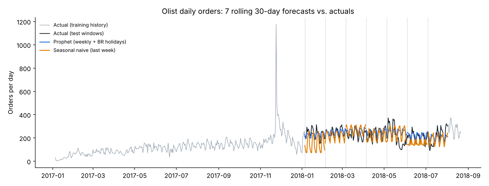

# Automated Business Insights Generator

A Streamlit app that turns a daily sales series into a 30-day revenue forecast, LLM-written analyst commentary and a formatted PDF report, plus a rolling backtest that measures how accurate the forecasting model is on real data.

## What it does

1. **Forecast:** fits Prophet to daily revenue and forecasts the next 30 days (`app/forecasting.py`).
2. **Explain:** sends a summary of the forecast to GPT-4o-mini, which drafts short analyst commentary and insights (`app/ai_insights.py`).
3. **Report:** shows everything in a Streamlit app and exports a PDF report with the chart, forecast table and commentary (`app/app.py`, `app/report_generator.py`).
4. **Backtest:** checks forecast accuracy out of sample on real e-commerce orders, against simple baselines (`app/backtest.py`, `scripts/run_backtest.py`).

The app runs on `data/sample_sales_data.csv`, a small illustrative file. The backtest uses real data, described below.

## Does the forecast beat a simple baseline?

**Data:** real daily order counts from the [Olist Brazilian e-commerce dataset](https://www.kaggle.com/datasets/olistbr/brazilian-ecommerce): 98,390 orders over 594 days, 5 Jan 2017 to 21 Aug 2018. Days after 21 Aug 2018 are excluded because data collection stops and the counts fall to near zero.

**Method:** rolling-origin backtest. Train on the first 365 days, forecast the next 30, score against what actually happened, move forward 30 days and repeat, giving 7 non-overlapping test windows (Jan to Aug 2018). Each model only ever sees data before its forecast window.

**Models compared:**
- **Prophet** with weekly seasonality and Brazilian public holidays. Yearly seasonality is off, since each training window holds at most about 1.5 years.
- **Seasonal naive:** repeat the last observed week. This is the baseline to beat.
- **Naive:** repeat the last observed day.

**Decision rule, fixed before running:** Prophet counts as better only if its average MAE is lower than seasonal naive's *and* it has the lower MAE in at least 5 of the 7 windows.

<!-- BACKTEST:START -->
| Model | MAE (orders/day) | RMSE | MAPE | sMAPE | MASE | Folds beating baseline (of 7) | MAE vs. baseline |
|---|---|---|---|---|---|---|---|
| Prophet (weekly + BR holidays) | 38.9 | 46.3 | 21.0% | 17.8% | 1.19 | 6 | -30.5% |
| Naive (last day) | 51.1 | 60.1 | 26.9% | 23.2% | 1.56 | 3 | -8.6% |
| Seasonal naive (last week) | 55.9 | 67.7 | 26.7% | 27.8% | 1.71 | — | — |

Excluding fold 1 (whose baseline copies the post-New Year lull), Prophet's MAE is 41.1 vs. 49.8 for seasonal naive (-17.5%).
<!-- BACKTEST:END -->

**Result:** Prophet passes the rule. Its errors are about 30% lower than repeating last week, and it wins 6 of 7 windows. The one loss, May to early June 2018, includes a sharp drop in orders in late May (it coincides with the nationwide truckers' strike in Brazil), which no model trained on history anticipated.

**Reading MASE:** MASE divides each model's 30-day error by the average error of predicting each training day from the same weekday one week earlier. That in-sample yardstick only looks 7 days ahead, so values above 1 are expected at a 30-day horizon. Compare models with each other, not with 1.



## Run it

```bash
pip install -r requirements.txt

# Rebuild the daily series from the raw Olist file (download it from Kaggle first)
python scripts/build_daily_orders.py path/to/olist_orders_dataset.csv

# Rerun the backtest; writes results/ and prints the decision rule outcome
python scripts/run_backtest.py

# Tests (no Prophet needed)
pip install -r requirements-ci.txt && pytest

# The app; needs OPENAI_API_KEY in app/.env
streamlit run app/app.py
```

If your network requires an extra CA certificate (for example behind a corporate proxy), set `EXTRA_CA_CERT` in `app/.env` to its file path.

## Tests

`pytest` checks the metrics against hand-computed values, confirms no forecast ever sees its test window, and checks that the results table in this README matches `results/backtest_summary.md` and the per-window scores. GitHub Actions runs the tests on every push.

## Data license

`data/olist_daily_orders.csv` is derived from the Olist dataset, published under [CC BY-NC-SA 4.0](https://creativecommons.org/licenses/by-nc-sa/4.0/). It is shared here under the same license, for non-commercial use, with attribution to Olist.
